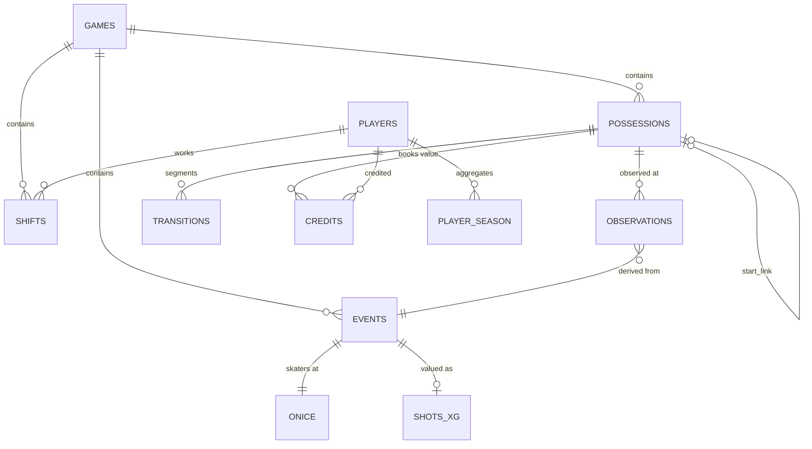

# Data Model, Lineage and Data Dictionary

DDL with column-level comments: [`schemas/pm_epa_events.sql`](../../schemas/pm_epa_events.sql). The transitions table's Parquet schema is in [`schemas/pm_epa_transitions.parquet`](../../schemas/pm_epa_transitions.parquet) (zero rows, schema only).

## Entity-relationship diagram

## Lineage

| Stage | Module | Reads | Writes |
|---|---|---|---|
| ingest | `src/ingestion/nhl_api.py` | NHL APIs | `data/raw/{schedule,pbp,shifts,rosters}/<season>/*.json.gz`, `manifest.json` |
| parse | `src/ingestion/parse.py` | raw | `games`, `events`, `shifts`, `players`, `data_quality.md` |
| on-ice / TOI | `src/possession/onice.py` | events, shifts, players | `onice`, `toi_game`, `shift_quality` |
| possessions | `src/possession/build.py` | events | `possessions`, `observations` (+ `_hits` variants) |
| xG | `src/xg/model.py` | events, players | `shots_xg`, `data/outputs/models/xg_temporal.joblib`, `xg_metrics.json` |
| value | `src/value/fit.py` | possessions, observations, shots_xg | `possessions_valued`, `data/value_surfaces/*`, `value_bakeoff.json`, `value_decision.json` |
| EPA | `src/epa/run.py` | the above + onice | `obs_valued`, `poss_valued_epa`, `transitions`, `credits`, `identity_check.json` |
| metrics | `src/metrics/aggregate.py` | credits, toi_game, shots_xg, onice | `player_game`, `player_season`, `data/outputs/*.csv` |
| validation | `src/validation/*` | player_season, player_game, … | `validation.json`, `ablations.json`, `reports/validation_report.md` |

## Data dictionary (row counts, full 9-season run)

| Table | Grain | Rows | Notes |
|---|---|---|---|
| games | game | 11,052 | regular season 2017-18 → 2025-26 |
| events | PBP event | 3,435,476 | shootouts dropped |
| shifts | player shift | 8,388,309 | typeCode 517 rows with end > start |
| onice | event | 3,435,476 | games with shift charts only |
| shots_xg | shot attempt | ≈1.3M | unblocked + blocked |
| possessions | possession | 1,925,919 | 174 per game |
| observations | observed state | 3,126,738 | ≤ 2 per possession without hits |
| transitions | movement segment | 1,166,827 | excluded (EN) possessions omitted |
| credits | credit × player | ≈11.9M | pool credits expanded to on-ice skaters |
| player_season | skater-season | 8,321 | 5,034 with ≥500 5v5 min |

Column semantics are documented inline in the DDL. Categorical vocabularies (`obs_kind`, `end_type`, `component`, `seg_type`, `strength`) are defined in [definitions.md](definitions.md).
