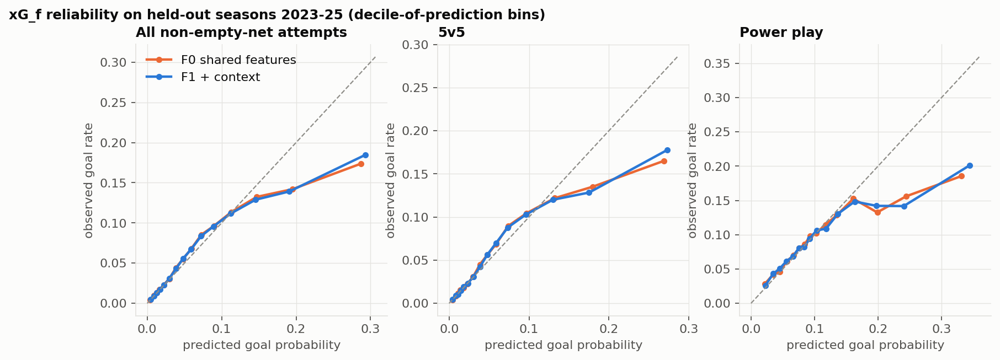

# xG_f validation (finishing-only xG offset)

Spec: [methodology §4](../../docs/finishing/methodology.md). F0 = the shared xG's features, F1 = F0 + previous-event ownership, lateral movement from the shooter's own team's previous event, time since faceoff, skater counts and recent own-team attempts. Same rows (unblocked, non-empty-net), same splits, same gradient-boosted model. Public play-by-play has no pass events, so pre-shot passing is not a feature.

**D-xG decision: F1 is used** (validation z = 4.7, test z = 9.9; rule: valid > 2 SE and test not worse).

## Held-out seasons (train 2017-21, validation 2022, test 2023-25)

| features | split | log-loss | AUC | Brier | Σxg÷Σgoals | ECE | calib slope |
|---|---|---|---|---|---|---|---|
| F0 | valid | 0.2245 | 0.7517 | 0.0608 | 1.0960 | 0.0080 | 0.8934 |
| F0 | test | 0.2261 | 0.7368 | 0.0609 | 1.1362 | 0.0150 | 0.7631 |
| F1 | valid | 0.2240 | 0.7534 | 0.0606 | 1.0987 | 0.0080 | 0.9010 |
| F1 | test | 0.2254 | 0.7390 | 0.0607 | 1.1369 | 0.0144 | 0.7762 |

Paired per-shot log-loss improvement of F1 over F0: validation 0.00054 (SE 0.00012); test 0.00069 (SE 0.00007). The temporal test over-predicts goals by ~14% for both feature sets. That is league-level drift, so the finishing model carries season × strength intercepts.



## Cross-fitted xG_f (each season scored by a model trained on the other eight)

| xG | log-loss | AUC | Σxg÷Σgoals | ECE |
|---|---|---|---|---|
| xG_f (F1) | 0.2154 | 0.7646 | 1.0078 | 0.0008 |
| shared xG on the same rows | 0.2163 | 0.7621 | 1.0082 | 0.0008 |

Gate F4 (5v5 Σxg÷Σgoals within [0.97, 1.03]): 1.0117 ✅

By season / by strength (Σxg ÷ Σgoals):

| season | attempts | goals | xg÷goals |
|---|---|---|---|
| 2017 | 111715 | 7097 | 0.995 |
| 2018 | 109579 | 7167 | 0.965 |
| 2019 | 92580 | 6128 | 0.983 |
| 2020 | 70881 | 4769 | 0.972 |
| 2021 | 112555 | 7674 | 1.002 |
| 2022 | 113347 | 7810 | 1.036 |
| 2023 | 114052 | 7639 | 1.006 |
| 2024 | 111293 | 7377 | 1.013 |
| 2025 | 111089 | 7578 | 1.076 |

| strength | attempts | goals | xg÷goals |
|---|---|---|---|
| 4v4_3v3 | 21269 | 2237 | 1.020 |
| 5v5 | 747925 | 44539 | 1.012 |
| PK | 23817 | 1700 | 0.993 |
| PP | 133265 | 13013 | 0.997 |
| pulled | 20815 | 1750 | 0.991 |

## Calibration of the cross-fitted offset the finishing model uses

The reliability curves above are the *temporal* holdout, which flattens at high xG (drift after 2021). The finishing model uses the cross-fitted xG_f, whose calibration is:

* pooled logit calibration slope **1.005** (5v5 1.007); top 1% of attempts: predicted 0.361, observed 0.369 (n = 9,471)
* per-season slope: 2017 1.03, 2018 1.03, 2019 1.06, 2020 1.09, 2021 1.01, 2022 0.99, 2023 1.01, 2024 0.97, 2025 0.93. Season × strength intercepts absorb level drift but **not** slope drift; 2025 (0.93) and 2020 (1.09) are the extremes. A per-season slope on the offset is a v1.1 candidate; until then, high-danger-shot specialists are the players most exposed to this.

| decile | mean xG_f | observed rate | observed ÷ xG_f |
|---|---|---|---|
| 1 | 0.0053 | 0.0051 | 0.9727 |
| 2 | 0.0117 | 0.0111 | 0.9499 |
| 3 | 0.0182 | 0.0179 | 0.9844 |
| 4 | 0.0273 | 0.0264 | 0.9702 |
| 5 | 0.0397 | 0.0400 | 1.0069 |
| 6 | 0.0552 | 0.0562 | 1.0182 |
| 7 | 0.0736 | 0.0735 | 0.9984 |
| 8 | 0.0967 | 0.0956 | 0.9893 |
| 9 | 0.1314 | 0.1292 | 0.9829 |
| 10 | 0.2139 | 0.2126 | 0.9941 |

## What F1's new features add (permutation importance, validation season, top 15)

| feature | Δ log-loss when shuffled |
|---|---|
| dist | 0.02689 |
| y_abs | 0.00775 |
| shot_type_c=snap | 0.00203 |
| x | 0.00181 |
| angle | 0.00145 |
| dt_prev | 0.00128 |
| shot_type_c=slap | 0.00103 |
| opp_skaters | 0.00079 |
| off_wing | 0.00075 |
| prev_y_abs_same | 0.00068 |
| strength=5v5 | 0.00062 |
| shot_type_c=wrist | 0.00055 |
| dist*backhand | 0.00049 |
| speed_prev | 0.00039 |
| shot_type_c=wrap-around | 0.00031 |

## Shot table integrity (gate F5)

```
{
 "goals_in_events": 66976,
 "goals_in_shot_features_table": 66971,
 "goals_without_coordinates": 5,
 "goals_on_blocked_rows": 0,
 "goals_empty_net": 3732,
 "goals_by_goalie_shooters": 0,
 "goals_in_finishing_table": 63239,
 "goals_unaccounted": 0,
 "rows": 947091,
 "rows_missing_xg_v1": 0,
 "rows_duplicate_keys": 0,
 "rows_goalie_null": 28,
 "goalie_ids_not_goalies": 0,
 "rows_by_strength": {
  "4v4_3v3": 21269,
  "PK": 23817,
  "5v5": 747925,
  "PP": 133265,
  "pulled": 20815
 },
 "rows_by_type_group": {
  "base": 652723,
  "slap": 130699,
  "tip": 94604,
  "back": 69065
 }
}
```