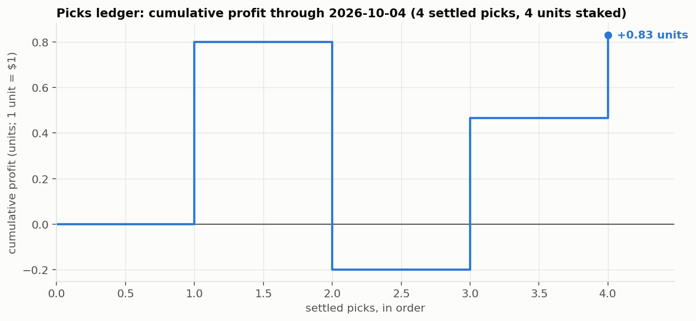

# Picks ledger

Rules: [docs/market/picks.md](../../docs/market/picks.md). One unit = $1; 1–3 units per pick; decimal odds as locked at the daily run. **Bookkeeping for the owner's own wagers, not advice; the model has no demonstrated edge over the market.**

**Season to date: +4.22 units ($+4.22) on 58 units staked; record 28–19; return +7.3% per unit (95% interval -19% to +32%).** 2 pick(s) pending (3 units).

## Locked, not yet played

| date | pick | units | odds (decimal) | book | model |
|---|---|---|---|---|---|
| 2026-10-18 | **MIN** over CBJ | 2 ($2) | 1.54 | BetMGM | 74.4% |
| 2026-10-18 | **CAR** over CGY | 1 ($1) | 1.48 | Caesars | 71.9% |

## By day

| date | picks | won | units staked | profit |
|---|---|---|---|---|
| 2026-10-17 | 7 | 3 | 9 | -2.55 |
| 2026-10-15 | 5 | 2 | 5 | -2.00 |
| 2026-10-14 | 2 | 1 | 2 | +0.30 |
| 2026-10-13 | 5 | 3 | 5 | +0.24 |
| 2026-10-12 | 1 | 1 | 2 | +2.30 |
| 2026-10-11 | 2 | 2 | 3 | +1.32 |
| 2026-10-10 | 4 | 3 | 4 | +0.80 |
| 2026-10-09 | 3 | 0 | 4 | -4.00 |
| 2026-10-08 | 3 | 3 | 6 | +4.19 |
| 2026-10-07 | 2 | 1 | 2 | +0.60 |
| 2026-10-06 | 6 | 4 | 8 | +2.84 |
| 2026-10-05 | 3 | 2 | 4 | -0.65 |
| 2026-10-04 | 4 | 3 | 4 | +0.83 |

## Settled picks (latest first)

| date | pick | units | odds (decimal) | book | score (away–home) | result | profit |
|---|---|---|---|---|---|---|---|
| 2026-10-17 | UTA over EDM | 1 | 1.77 | theScore Bet | EDM 6–2 UTA (REG) | lost | -1.00 |
| 2026-10-17 | BUF over MTL | 1 | 2.21 | Caesars | BUF 3–4 MTL (OT) | lost | -1.00 |
| 2026-10-17 | DET over SJS | 1 | 1.78 | FanDuel | SJS 3–4 DET (SO) | won | +0.78 |
| 2026-10-17 | OTT over PHI | 2 | 1.71 | Hard Rock Bet | OTT 1–3 PHI (REG) | lost | -2.00 |
| 2026-10-17 | NYR over CBJ | 1 | 2.14 | Caesars | NYR 0–1 CBJ (OT) | lost | -1.00 |
| 2026-10-17 | DAL over CHI | 2 | 1.54 | Hard Rock Bet | DAL 4–0 CHI (REG) | won | +1.08 |
| 2026-10-17 | CAR over WPG | 1 | 1.59 | Hard Rock Bet | CAR 3–2 WPG (REG) | won | +0.59 |
| 2026-10-15 | WPG over CHI | 1 | 1.79 | FanDuel | WPG 3–4 CHI (OT) | lost | -1.00 |
| 2026-10-15 | NSH over SJS | 1 | 1.72 | FanDuel | SJS 3–2 NSH (SO) | lost | -1.00 |
| 2026-10-15 | OTT over NYI | 1 | 1.65 | BetMGM | NYI 1–2 OTT (SO) | won | +0.65 |
| 2026-10-15 | FLA over VAN | 1 | 1.35 | FanDuel | VAN 2–3 FLA (OT) | won | +0.35 |
| 2026-10-15 | NYR over NJD | 1 | 2.20 | DraftKings | NYR 1–7 NJD (REG) | lost | -1.00 |
| 2026-10-14 | DAL over COL | 1 | 2.30 | DraftKings | DAL 3–2 COL (SO) | won | +1.30 |
| 2026-10-14 | MTL over WSH | 1 | 2.12 | FanDuel | MTL 4–5 WSH (REG) | lost | -1.00 |
| 2026-10-13 | BOS over SJS | 1 | 1.95 | FanDuel | BOS 6–3 SJS (REG) | won | +0.95 |
| 2026-10-13 | UTA over TOR | 1 | 1.65 | BetMGM | TOR 4–5 UTA (REG) | won | +0.65 |
| 2026-10-13 | DAL over COL | 1 | 1.95 | BetMGM | COL 3–2 DAL (REG) | lost | -1.00 |
| 2026-10-13 | CAR over WSH | 1 | 1.65 | DraftKings | WSH 2–4 CAR (REG) | won | +0.65 |
| 2026-10-13 | DET over NJD | 1 | 1.91 | BetMGM | NJD 5–4 DET (OT) | lost | -1.00 |
| 2026-10-12 | OTT over NJD | 2 | 2.15 | BetMGM | OTT 4–1 NJD (REG) | won | +2.30 |
| 2026-10-11 | CAR over PHI | 1 | 1.56 | DraftKings | CAR 4–1 PHI (REG) | won | +0.56 |
| 2026-10-11 | NYR over VAN | 2 | 1.38 | FanDuel | VAN 2–6 NYR (REG) | won | +0.77 |
| 2026-10-10 | VGK over LAK | 1 | 1.62 | BetMGM | LAK 1–2 VGK (OT) | won | +0.62 |
| 2026-10-10 | DAL over PIT | 1 | 1.66 | FanDuel | DAL 1–2 PIT (SO) | lost | -1.00 |
| 2026-10-10 | CAR over CHI | 1 | 1.41 | DraftKings | CAR 5–2 CHI (REG) | won | +0.41 |
| 2026-10-10 | STL over CBJ | 1 | 1.77 | DraftKings | CBJ 3–5 STL (REG) | won | +0.77 |
| 2026-10-09 | WPG over ANA | 1 | 1.85 | FanDuel | ANA 5–1 WPG (REG) | lost | -1.00 |
| 2026-10-09 | NYR over WSH | 2 | 2.22 | FanDuel | NYR 1–3 WSH (REG) | lost | -2.00 |
| 2026-10-09 | PIT over CBJ | 1 | 2.05 | BetMGM | PIT 2–3 CBJ (SO) | lost | -1.00 |
| 2026-10-08 | NSH over MTL | 1 | 2.50 | DraftKings | NSH 5–2 MTL (REG) | won | +1.50 |
| 2026-10-08 | OTT over PHI | 3 | 1.69 | FanDuel | PHI 1–2 OTT (REG) | won | +2.08 |
| 2026-10-08 | CAR over VAN | 2 | 1.30 | FanDuel | VAN 2–7 CAR (REG) | won | +0.61 |
| 2026-10-07 | PIT over WSH | 1 | 2.36 | DraftKings | PIT 3–5 WSH (REG) | lost | -1.00 |
| 2026-10-07 | WPG over COL | 1 | 2.60 | DraftKings | COL 2–3 WPG (REG) | won | +1.60 |
| 2026-10-06 | FLA over LAK | 1 | 1.85 | FanDuel | FLA 2–1 LAK (REG) | won | +0.85 |
| 2026-10-06 | STL over CHI | 1 | 1.75 | FanDuel | STL 2–4 CHI (REG) | lost | -1.00 |
| 2026-10-06 | NYR over NYI | 3 | 1.68 | FanDuel | NYI 2–5 NYR (REG) | won | +2.05 |
| 2026-10-06 | NSH over TOR | 1 | 2.30 | DraftKings | NSH 4–5 TOR (OT) | lost | -1.00 |
| 2026-10-06 | CAR over MTL | 1 | 1.83 | BetMGM | CAR 6–4 MTL (REG) | won | +0.83 |
| 2026-10-06 | UTA over NJD | 1 | 2.10 | BetMGM | UTA 5–3 NJD (REG) | won | +1.10 |
| 2026-10-05 | DAL over SJS | 1 | 1.50 | BetMGM | SJS 0–5 DAL (REG) | won | +0.50 |
| 2026-10-05 | OTT over BOS | 1 | 1.85 | DraftKings | OTT 4–1 BOS (REG) | won | +0.85 |
| 2026-10-05 | PIT over WPG | 2 | 1.57 | FanDuel | WPG 3–2 PIT (REG) | lost | -2.00 |
| 2026-10-04 | VGK over VAN | 1 | 1.36 | BetMGM | VGK 3–2 VAN (REG) | won | +0.36 |
| 2026-10-04 | FLA over ANA | 1 | 1.75 | FanDuel | FLA 2–3 ANA (OT) | lost | -1.00 |
| 2026-10-04 | SEA over CGY | 1 | 1.67 | BetMGM | CGY 1–6 SEA (REG) | won | +0.67 |
| 2026-10-04 | NYR over UTA | 1 | 1.80 | BetMGM | UTA 2–4 NYR (REG) | won | +0.80 |
